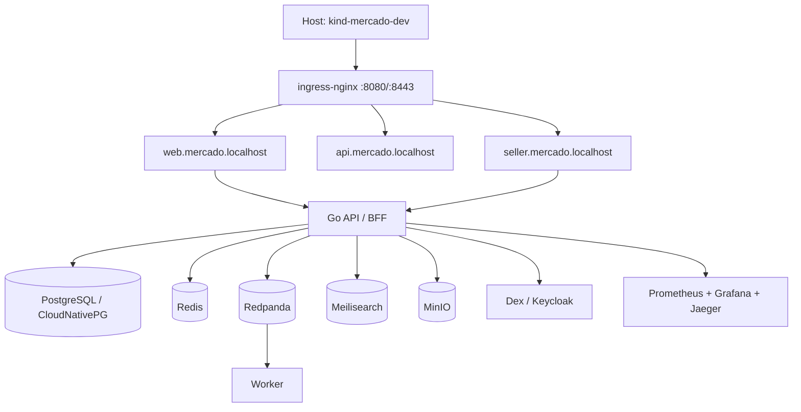
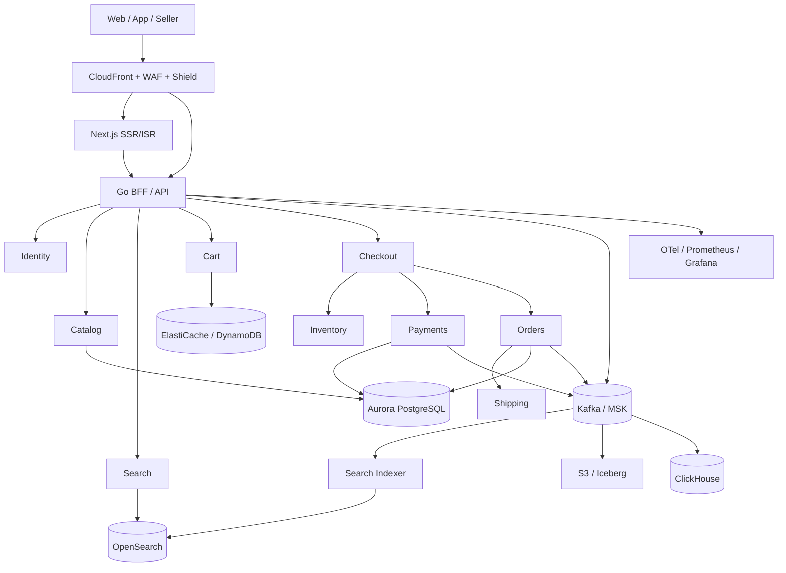

# PRD — Mercado

**Nome provisório:** Mercado  
**Versão:** 0.1  
**Status:** Draft  
**Data:** 2026-10-22  
**Owner:** TBD  
**Licença planejada:** MIT

> Marketplace inspirado em grandes plataformas de e-commerce latino-americanas. Este documento não implica afiliação com o Mercado Livre. "Mercado Livre" é usado apenas como benchmark público de escala.

---

## 1. Sumário executivo

O objetivo é construir um marketplace com backend em **Go**, frontend em **React/Next.js** e infraestrutura em **Kubernetes local** para desenvolvimento, integração e testes de carga moderada.

A arquitetura deve ser evolutiva:

- **Agora:** cluster Kubernetes local dedicado, com stack leve, para validar o produto e os fluxos críticos.
- **Depois:** os mesmos manifestos e contratos devem permitir promoção para um cluster Kubernetes de produção, como EKS ou cluster self-hosted multi-AZ.
- **Escala:** a arquitetura deve estar preparada para cells, sharding, eventos, multi-região e multi-cloud, mas sem tentar operar a escala do Mercado Livre no cluster local.

**Decisão central:** Kubernetes local é ambiente de desenvolvimento e integração. Ele não é HA, não tem multi-AZ, não absorve DDoS de 15M RPS e não suporta 120M de compradores. A meta de escala do Mercado Livre é uma referência de arquitetura de produção, não um critério de aceite do MVP local.

---

## 2. Problema e oportunidade

Pequenos e médios vendedores precisam de uma plataforma confiável para:

- Publicar e gerenciar anúncios.
- Serem encontrados por compradores.
- Vender com checkout simples e seguro.
- Controlar estoque e pedidos.
- Acompanhar entregas e reputação.

Compradores precisam de:

- Busca relevante.
- Comparação de preços e fretes.
- Checkout rápido e confiável.
- Acompanhamento de pedidos.
- Confiança no vendedor e nas políticas de devolução.

A oportunidade é validar um marketplace com arquitetura de engenharia sólida desde o início, usando Kubernetes local para baixo custo de desenvolvimento, mas sem comprometer a portabilidade para produção.

---

## 3. Objetivos e não-objetivos

### 3.1 Objetivos

1. Entregar um MVP funcional de marketplace com comprador, vendedor e administração.
2. Rodar o ambiente de desenvolvimento em Kubernetes local com `kind`.
3. Usar Go no backend, React/Next.js no frontend e contratos REST/gRPC bem definidos.
4. Implementar checkout, pedidos, estoque e pagamento simulado com consistência e idempotência.
5. Criar observabilidade mínima: métricas, logs, traces e dashboards.
6. Preparar a arquitetura para cells, sharding, Kafka, multi-região e serviços gerenciados em produção.
7. Manter o ambiente local reproduzível com um comando.
8. Validar carga local de 1k–10k RPS e fluxos críticos com k6.

### 3.2 Não-objetivos do MVP

- Atingir a escala real do Mercado Livre no cluster local.
- Operar malha logística própria, armazéns ou robótica.
- Emitir cartão, crédito, wallet ou produtos financeiros regulados.
- Processar pagamentos reais com cartão antes da fase de produção.
- Ser multi-cloud ativo.
- Ter 35 mil microserviços.
- Ter 20 mil profissionais de tecnologia.
- Garantir PCI DSS completo no MVP local.
- Ter app mobile nativo no MVP; o foco é web responsivo/PWA.

---

## 4. Personas

| Persona | Necessidades principais |
|---|---|
| Comprador | Encontrar produto, comparar, comprar, pagar, acompanhar pedido, avaliar |
| Vendedor | Cadastrar anúncio, controlar estoque, receber pedidos, emitir etiqueta, acompanhar reputação |
| Administrador | Moderar catálogo, resolver disputas, gerenciar categorias e taxas |
| Analista de risco | Detectar fraude, chargeback, abuso e contas comprometidas |
| Atendimento | Consultar pedidos, reembolsos, disputas e histórico |
| Engenheiro de plataforma | Operar cluster, CI/CD, observabilidade, segurança e custos |

---

## 5. Escopo

### 5.1 MVP local

- Cadastro/login de comprador e vendedor.
- Onboarding básico de vendedor.
- Categorias e anúncios.
- Busca, filtros e ordenação.
- Página de produto.
- Carrinho.
- Checkout com provedor de pagamento simulado.
- Reserva de estoque.
- Criação e consulta de pedidos.
- Notificações por email local (Mailpit).
- Painel do vendedor.
- Painel administrativo básico.
- Upload de imagens em MinIO.
- Seed de dados sintéticos.
- Observabilidade mínima.
- Testes de carga e smoke tests.

### 5.2 Pós-MVP

- Pagamento real com PSP.
- Frete real e rastreamento de carriers.
- Devoluções e reembolsos.
- Avaliações e reputação.
- Recomendações.
- Anúncios patrocinados.
- Cupons e promoções.
- Multi-moeda e impostos por país.
- Antifraude com regras e ML.
- App mobile.
- Integrações fiscais.

### 5.3 Fora de escopo

- Fintech regulada, crédito, cartão e investimentos.
- Rede logística própria.
- Marketplace de imóveis, veículos e serviços.
- Publicidade de terceiros em escala.
- Operação multi-cloud ativa.
- Paridade funcional total com o Mercado Livre.

---

## 6. Benchmarks e metas de capacidade

### 6.1 Referência pública do Mercado Livre em 2025

| Métrica | Referência |
|---|---:|
| Compradores únicos/ano | 121M |
| Compradores ativos no trimestre | 83M |
| Itens vendidos/ano | 2,4B |
| Anúncios ativos | 635M |
| Transações de pagamento/ano | 15,5B |
| Compras por segundo | ~95 |
| Pagamentos por segundo | ~566 |
| Pico de tráfego | ~15M RPS |
| Microserviços | ~35 mil |
| Instâncias | ~130 mil |
| Clouds | 3 |
| Profissionais de tecnologia | ~20 mil |

Esses números são referência de arquitetura de produção. Não são metas do MVP local.

### 6.2 Metas do projeto

| Dimensão | MVP local | North Star de produção |
|---|---:|---:|
| Compradores únicos/ano | 100k simulados | 120M |
| MAU | 100k simulados | 40M |
| DAU | 10k simulados | 10M |
| Pedidos/ano | 1k/dia simulado | ~600M |
| Itens/ano | 10k/dia simulado | ~2,4B |
| Pagamentos/ano | simulado | ~15B |
| Anúncios | 10k | 635M |
| RPS de API | 1k–10k em teste | 50k médio / 500k pico |
| RPS no edge | não aplicável | 1–2M normal / 15M em ataque |
| WebSockets simultâneos | 1k | 1–5M |
| Mídia | 10 GB | 5–10 PB |
| Índice de busca | 10k docs | 10–30 TB |
| OLTP | 10 GB | 5–10 TB |

### 6.3 Fórmulas de capacidade

- Pedidos/s médio = pedidos anuais / 31.536.000 s.
- 600M pedidos/ano ≈ 19 pedidos/s médio.
- Pico de 10x ≈ 190 pedidos/s.
- 15B pagamentos/ano ≈ 476 pagamentos/s médio.
- Pico de 10x ≈ 4.760 pagamentos/s.
- 2,4B itens/ano ≈ 76 itens/s médio.
- 500k RPS de API exige dezenas a centenas de pods, dependendo do p95 e do custo por request.

---

## 7. Métricas de sucesso

### 7.1 Produto

- Taxa de conversão do funil: visita → produto → carrinho → checkout → pedido pago.
- GMV e número de pedidos.
- Ticket médio.
- Tempo até o primeiro anúncio de um novo vendedor.
- Retenção de compradores e vendedores.
- NPS de comprador e vendedor.
- Taxa de cancelamento, reembolso e disputa.
- Taxa de fraude e chargeback.
- Tempo de entrega e cumprimento de SLA.

### 7.2 Engenharia

- Disponibilidade e error budget.
- p95/p99 de busca, catálogo, checkout e pagamentos.
- Latência de indexação de anúncios.
- Lead time de deploy.
- Frequência de deploy.
- MTTR.
- Cobertura de testes dos fluxos críticos.
- Número de incidentes Sev-1/Sev-2.
- Custo por pedido e custo por MAU.
- Cache hit ratio de CDN e aplicação.

### 7.3 Critérios de sucesso do MVP local

- Comprador consegue buscar, adicionar ao carrinho, finalizar compra simulada e consultar pedido.
- Vendedor consegue criar anúncio, ajustar estoque e visualizar pedidos.
- Administrador consegue moderar anúncio e consultar pedidos.
- Migrations e seed rodam do zero em menos de 10 minutos.
- Teste de carga de 1k RPS por 10 minutos com erro < 1%.
- p95 de busca < 300 ms e p95 de checkout < 1 s no cluster local.
- Deploy local completo em menos de 10 minutos.
- Rollback em menos de 5 minutos.
- Nenhuma vulnerabilidade crítica conhecida em imagens e dependências.

---

## 8. Requisitos funcionais

Prioridades: **MUST** para MVP, **SHOULD** para pós-MVP próximo, **COULD** para evolução.

### 8.1 Comprador

| ID | Requisito | Prioridade | Critério de aceite |
|---|---|---|---|
| FR-001 | Cadastro e login com email/senha | MUST | Usuário cria conta, confirma email e faz login |
| FR-002 | Login social/OIDC | SHOULD | Login via provedor OIDC configurado |
| FR-003 | Passkeys e MFA | SHOULD | Usuário cadastra passkey e ativa MFA |
| FR-004 | Busca por texto | MUST | Retorna anúncios relevantes com paginação |
| FR-005 | Filtros por categoria, preço, condição e frete | MUST | Filtros combináveis e refletidos na URL |
| FR-006 | Ordenação por relevância, preço e mais recentes | MUST | Ordenação estável e testada |
| FR-007 | Página de produto | MUST | Exibe título, imagens, preço, estoque, vendedor e frete |
| FR-008 | Carrinho | MUST | Adiciona, remove, altera quantidade e persiste entre sessões |
| FR-009 | Checkout | MUST | Valida carrinho, endereço, estoque e pagamento simulado |
| FR-010 | Pagamento simulado | MUST | Fake PSP aprova, recusa e timeout de forma determinística |
| FR-011 | Pedido | MUST | Pedido é criado com status e itens consistentes |
| FR-012 | Consulta de pedidos | MUST | Comprador lista e detalha seus pedidos |
| FR-013 | Notificações | MUST | Email local em Mailpit para pedido criado/pago |
| FR-014 | Avaliações | SHOULD | Comprador avalia pedido entregue |
| FR-015 | Rastreamento | SHOULD | Exibe status logístico simulado |
| FR-016 | Devolução/reembolso | COULD | Fluxo básico de solicitação e aprovação |
| FR-017 | Recomendações | COULD | Produtos relacionados por categoria e popularidade |

### 8.2 Vendedor

| ID | Requisito | Prioridade | Critério de aceite |
|---|---|---|---|
| FR-020 | Onboarding de vendedor | MUST | Vendedor conclui perfil e dados obrigatórios |
| FR-021 | Criar/editar anúncio | MUST | Anúncio tem título, categoria, preço, estoque e imagens |
| FR-022 | Upload de imagens | MUST | Imagens salvas em MinIO e servidas via URL |
| FR-023 | Gestão de estoque | MUST | Ajustes refleem disponibilidade no catálogo |
| FR-024 | Gestão de pedidos | MUST | Vendedor vê pedidos e atualiza status permitido |
| FR-025 | Painel de vendas | MUST | Métricas básicas de pedidos e receita |
| FR-026 | Precificação e promoções | SHOULD | Vendedor cria desconto simples |
| FR-027 | Etiqueta de envio | SHOULD | Gera etiqueta simulada |
| FR-028 | Reputação | SHOULD | Exibe avaliações e métricas do vendedor |

### 8.3 Administração e risco

| ID | Requisito | Prioridade | Critério de aceite |
|---|---|---|---|
| FR-030 | Moderação de anúncios | MUST | Admin aprova, rejeita ou suspende anúncio |
| FR-031 | Gestão de categorias | MUST | CRUD de categorias e atributos |
| FR-032 | Consulta de pedidos | MUST | Admin busca pedido por ID, comprador e vendedor |
| FR-033 | Gestão de usuários | SHOULD | Admin suspende conta com motivo auditável |
| FR-034 | Disputas | SHOULD | Admin registra e resolve disputa |
| FR-035 | Regras antifraude | COULD | Regras de velocidade e valor bloqueiam pedidos suspeitos |
| FR-036 | Auditoria | MUST | Ações administrativas registradas com autor e timestamp |

### 8.4 Plataforma

| ID | Requisito | Prioridade | Critério de aceite |
|---|---|---|---|
| FR-040 | API REST versionada | MUST | OpenAPI 3.1 publicado e validado em CI |
| FR-041 | Contratos internos gRPC | SHOULD | Protobufs versionados e compatíveis |
| FR-042 | Idempotência | MUST | Checkout e pagamento aceitam `Idempotency-Key` |
| FR-043 | Outbox | MUST | Eventos são publicados de forma transacional |
| FR-044 | Consumidores idempotentes | MUST | Reprocessamento não duplica efeitos |
| FR-045 | Feature flags | SHOULD | Funcionalidades podem ser ativadas por ambiente |
| FR-046 | Rate limiting | MUST | Limites por IP, usuário e API key |
| FR-047 | Observabilidade | MUST | Métricas, logs e traces com correlation ID |
| FR-048 | Exportação/exclusão LGPD | SHOULD | Usuário solicita exportação/exclusão de dados |
| FR-049 | Health/readiness | MUST | Endpoints distintos e usados pelo Kubernetes |
| FR-050 | Migrations | MUST | Expand/contract e rollback documentado |

---

## 9. Requisitos não funcionais

### 9.1 Disponibilidade e performance

| Serviço | Disponibilidade alvo em produção | Latência alvo |
|---|---:|---:|
| Catálogo/Browse | 99,99% | p95 < 200 ms |
| Busca | 99,99% | p95 < 150 ms |
| Checkout | 99,95% | p95 < 800 ms |
| Pagamentos | 99,95% | p99 < 2 s |
| Seller Center | 99,9% | p95 < 500 ms |
| Administração | 99,9% | p95 < 1 s |

No cluster local, as metas são **best effort**. A disponibilidade de produção depende de multi-AZ, multi-região, dados gerenciados e SRE.

### 9.2 Escalabilidade

- Escalar horizontalmente por réplicas.
- HPA para serviços stateless.
- Arquitetura preparada para cells.
- Sharding por `cell_id` ou país na camada de dados.
- Limite de blast radius por cell.
- Nenhum estado local em pod.
- Conexões de banco via pooler.
- Cache com TTL e proteção contra stampede.

### 9.3 Durabilidade e DR

| Camada | RTO | RPO |
|---|---:|---:|
| Pedidos/Pagamentos | 15 min | 5 min |
| Catálogo/Busca | 1 h | 15 min |
| Analytics | 24 h | 24 h |

- Backups com PITR.
- Restore testado periodicamente.
- S3 versionado e replicado em produção.
- Runbooks de failover.

### 9.4 Segurança

- OWASP Top 10.
- Autenticação OIDC/OAuth2.
- Senhas com Argon2id.
- Sessões HttpOnly/Secure/SameSite.
- MFA e passkeys.
- Autorização por recurso, não apenas por frontend.
- Proteção contra IDOR, SSRF, CSRF e injeção.
- Secrets fora do repositório.
- Imagens não-root e read-only quando possível.
- SBOM e assinatura de imagens.
- Scan de dependências e imagens.
- Rate limiting e bot management.
- Criptografia em trânsito e repouso.
- Auditoria de ações administrativas.

### 9.5 Privacidade e compliance

- LGPD desde o desenho.
- Minimização de dados.
- Base legal e consentimento documentados.
- Direito de acesso, correção e exclusão.
- Retenção definida por tipo de dado.
- PII não deve aparecer em logs.
- PCI DSS fora de escopo no MVP por uso de PSP simulado.
- Em produção, reduzir escopo PCI via tokenização e hosted fields.

### 9.6 Acessibilidade, SEO e i18n

- WCAG 2.2 AA.
- Navegação por teclado.
- Contraste e foco visível.
- SSR/ISR para páginas públicas.
- Structured data, sitemap e canonical.
- hreflang para pt-BR e es.
- Performance: LCP < 2,5 s, INP < 200 ms, CLS < 0,1 em produção.
- Bundle inicial controlado e code splitting.

### 9.7 Portabilidade e FinOps

- Manifestos Kubernetes portáveis.
- Evitar dependências proprietárias na camada de aplicação.
- Interfaces para busca, eventos, storage e pagamento.
- Tags de custo em todos os recursos de produção.
- Orçamento e alertas de anomalia.
- Retenção de logs e traces com sampling.
- Cache agressivo para mídia e catálogo público.

---

## 10. Arquitetura de referência

### 10.1 Princípios

1. **Monólito modular primeiro.** Microserviços são uma decisão organizacional e de escala, não um ponto de partida.
2. **Contratos explícitos.** OpenAPI para HTTP, Protobuf para gRPC e eventos versionados.
3. **Event-driven onde faz sentido.** Outbox + Kafka para pedidos, pagamentos e indexação.
4. **Cells para blast radius.** A aplicação nasce preparada para ser particionada.
5. **Dados gerenciados em produção.** Local usa substitutos leves; produção usa serviços gerenciados.
6. **Observabilidade desde o primeiro deploy.**
7. **Segurança por padrão.**
8. **Tudo reproduzível.** Local, staging e produção via GitOps.

### 10.2 Backend

- Go 1.22+.
- `net/http` + `chi`.
- `pgx/v5` + `sqlc`.
- `franz-go` para Kafka/Redpanda.
- `go-redis/v9`.
- OpenTelemetry + Prometheus.
- `slog` para logs estruturados.
- `golangci-lint`, `govulncheck`, `gosec`.
- Testcontainers para integração.
- k6 para carga.

Domínios iniciais:

- Identity
- Seller
- Catalog
- Search
- Inventory
- Cart
- Checkout
- Orders
- Payments
- Shipping
- Notifications
- Fraud
- Admin
- Analytics

Serviços extraídos primeiro, quando necessário:

1. Search/Indexer
2. Checkout/Orders
3. Payments/Ledger
4. Inventory
5. Fraud

### 10.3 Frontend

- Next.js com App Router.
- React Server Components e SSR/ISR.
- TypeScript.
- TanStack Query para server state.
- Zustand para estado local.
- React Hook Form + Zod.
- Tailwind CSS + shadcn/ui.
- Playwright, Vitest, Storybook.
- Sentry/Faro para RUM.
- BFF em Go para sessão, agregação e autorização.

Apps:

- `web`: comprador.
- `seller`: vendedor.
- `admin`: administração.

### 10.4 Diagrama local



### 10.5 Diagrama de produção



### 10.6 Cells

- Uma cell é uma unidade independente de deploy e dados.
- Cada cell tem EKS/namespace, Postgres, Redis, partições Kafka e índice de busca.
- No pico: 20–40 cells de 3–6M de usuários.
- Começar com 1 cell.
- Incluir `cell_id` nos IDs e no roteamento desde o início.
- Deploy progressivo por cell.
- Falha de uma cell afeta apenas parte da base.

### 10.7 Checkout

Fluxo saga:

1. Validar carrinho.
2. Reservar estoque.
3. Autorizar pagamento.
4. Criar pedido.
5. Capturar pagamento.
6. Emitir evento.
7. Iniciar fulfillment.

Requisitos:

- Outbox transacional.
- Consumidores idempotentes.
- Compensação em caso de falha.
- DLQ.
- Reconciliação diária.
- `Idempotency-Key`.
- Ledger de dupla entrada em produção.
- Nunca armazenar PAN.

---

## 11. Dados e consistência

### 11.1 Consistência

| Domínio | Consistência | Estratégia |
|---|---|---|
| Estoque | Forte | Transação + reserva com TTL |
| Pedido | Forte | Transação local por cell |
| Pagamento | Forte | Ledger + idempotência + reconciliação |
| Catálogo público | Eventual | CDC/Kafka + cache |
| Busca | Eventual | Indexação assíncrona |
| Recomendações | Eventual | Batch + online features |
| Analytics | Eventual | Kafka + lakehouse |
| Notificações | Eventual | Fila + retry |

### 11.2 Data stores

| Necessidade | Local | Produção |
|---|---|---|
| OLTP | PostgreSQL/CloudNativePG | Aurora PostgreSQL ou CloudNativePG multi-AZ |
| Cache/sessão/rate limit | Redis | ElastiCache |
| Carrinho/idempotência | Redis no MVP local | DynamoDB |
| Busca | Meilisearch/Typesense | OpenSearch |
| Eventos | Redpanda | MSK |
| Mídia | MinIO | S3 + CloudFront |
| Analytics | PostgreSQL/arquivos | ClickHouse + S3/Iceberg |
| Observabilidade | Prometheus/Grafana/Jaeger | Mimir/Loki/Tempo/Grafana |

### 11.3 Regras de dados

- IDs UUIDv7/ULID.
- `orders` particionado por mês em produção.
- Sem joins entre cells.
- Archive de pedidos antigos para lakehouse.
- PII classificada e criptografada.
- Retenção de logs sem PII.
- Backups testados.
- Migrations expand/contract.
- Seed local com dados sintéticos.

---

## 12. Infraestrutura local

### 12.1 Auditoria do ambiente e limpeza

**Estado antes da limpeza (2026-10-22):**

| Item | Estado |
|---|---|
| Cluster atual | kind `raiz-comum`, 1 control-plane, Kubernetes v1.37 |
| Outro cluster | kind `rancher` |
| Recursos | 8 vCPU, 15 GB RAM, ~1,7 GB disponível |
| Disco | ~225 GB, 95% usado, ~11 GB livres |
| Já rodando | Rancher, Elasticsearch, Kibana, WordPress, MySQL, Umbrel e outros |
| Ferramentas | kind 0.33, Helm 3.22, kubectl 1.37, Docker 29.9, metrics-server, local-path, k6 |
| Faltando | ingress-nginx, cert-manager, Tilt/Skaffold, Argo CD |
| Bloqueios | RAM e disco; clusters atuais não isolados para o projeto |

Consumo aproximado antes da limpeza:

- `raiz-comum`: ~3,7 GB de RAM.
- `rancher`: ~4,5 GB de RAM.
- Elasticsearch + Kibana: ~2,3 GB de RAM.
- Docker: ~19 GB de imagens, ~31 GB de volumes e ~11 GB de build cache.

**Limpeza executada em 2026-10-22:**

- Build cache removido: ~11,1 GB.
- Containers parados e imagens não usadas removidos: ~12,7 GB.
- Clusters `raiz-comum` e `rancher` parados; dados preservados.
- Volumes Docker não foram apagados para não destruir dados de outros projetos.
- A remoção definitiva dos clusters e volumes antigos continua pendente de autorização.

**Estado após a limpeza:**

| Item | Estado |
|---|---|
| Recursos | 8 vCPU, 15 GB RAM, ~9,5 GB disponível |
| Disco | ~225 GB, 86% usado, ~32 GB livres |
| Clusters kind | `raiz-comum` e `rancher` parados; dados preservados |
| Docker | 10 imagens, ~6,5 GB; volumes ~31 GB (dados de outros projetos) |
| Build cache | 0 B |
| Bloqueios | Nenhum bloqueio imediato para o MVP local com stack leve |
| Observação | O cluster `mercado-dev` ainda não foi criado |

### 12.2 Decisão de cluster

Criar um cluster dedicado:

- Nome: `mercado-dev`.
- Distribuição: `kind`.
- Inicialmente 1 control-plane.
- 2 workers apenas se houver RAM e disco liberados.
- Não reutilizar `raiz-comum` nem `rancher`.
- Portas do host: `8080` e `8443`, porque `80` está em uso pelo Umbrel.
- Ingress: `ingress-nginx` com `ingress-ready=true`.
- StorageClass: `local-path`.
- Namespaces: `mercado`, `mercado-data`, `mercado-observability`.
- `ResourceQuota` e `LimitRange`.
- Hosts: `mercado.localhost`, `api.mercado.localhost`, `seller.mercado.localhost`, `admin.mercado.localhost`.

### 12.3 Stack local

| Componente | Local | Produção |
|---|---|---|
| PostgreSQL | CloudNativePG, 1 instância | Aurora ou CloudNativePG multi-AZ |
| Redis | 1 pod | ElastiCache |
| Kafka | Redpanda, 1 nó | MSK |
| Busca | Meilisearch ou Typesense | OpenSearch |
| Object storage | MinIO | S3 |
| Auth | Dex ou Keycloak | Ory/Keycloak/Auth0 |
| Pagamento | Fake PSP | Mercado Pago/Stripe/Adyen |
| Email | Mailpit | SES |
| Observabilidade | Prometheus + Grafana + Jaeger | Mimir + Loki + Tempo |
| Ingress | ingress-nginx | ALB/Envoy Gateway + CloudFront |
| GitOps | Kustomize + Tilt | Argo CD |

### 12.4 Orçamento de recursos

| Categoria | RAM alvo |
|---|---:|
| Sistema kind + ingress + DNS + metrics | 1,5 GB |
| App: web + api + worker | 1 GB |
| Dados: Postgres + Redis + Redpanda + Meilisearch + MinIO | 2 GB |
| Auth | 0,5 GB |
| Observabilidade mínima | 1 GB |
| Buffer | 1 GB |
| **Total** | **~7 GB** |

Após a limpeza, há ~9,5 GB de RAM disponíveis e ~32 GB de disco livre. Isso é suficiente para o MVP local com stack leve, mas não para paridade pesada (OpenSearch/Kafka/Keycloak) nem para produção.

### 12.5 Limitações do ambiente local

- Sem HA real.
- Sem multi-AZ.
- Sem DDoS de 15M RPS.
- Sem 120M de usuários.
- Sem PCI DSS.
- Sem pagamentos reais.
- Sem SLA.
- Sem elasticidade de nuvem.
- Dados sintéticos.
- Carga local de 1k–10k RPS, não 500k RPS.
- Seed de 100k–1M usuários, não 120M.

---

## 13. Segurança

### 13.1 Autenticação e autorização

- OIDC/OAuth2.
- Argon2id para senhas.
- MFA e passkeys.
- Sessões curtas e revogáveis.
- RBAC para admin e seller.
- Autorização no backend em todas as rotas.
- Testes de IDOR.

### 13.2 Segredos e supply chain

- Secrets fora do Git.
- `.env.local` no `.gitignore`.
- Secrets Manager em produção.
- Imagens assinadas com cosign.
- SBOM.
- Scan de vulnerabilidades.
- Dependências pinadas.
- Renovate/Dependabot.

### 13.3 Proteção de aplicação

- WAF em produção.
- Rate limiting.
- Bot management.
- Validação de input.
- Output encoding.
- CSP e Trusted Types.
- CSRF protection.
- SSRF protection.
- Upload com validação de tipo e antivírus em produção.
- Logs sem PII.

### 13.4 Compliance

- LGPD no MVP.
- PCI DSS fora de escopo no MVP.
- Em produção, usar PSP e tokenização.
- Auditoria de ações administrativas.
- Política de retenção.
- Plano de resposta a incidentes.
- Pentest antes de produção.

---

## 14. Observabilidade e SRE

### 14.1 Sinais

- Métricas RED: rate, errors, duration.
- USE: utilization, saturation, errors.
- Logs estruturados JSON.
- Traces distribuídos com OpenTelemetry.
- RUM para Core Web Vitals.
- Synthetic monitoring de busca e checkout.
- Dashboards por domínio e por cell.

### 14.2 Práticas

- SLOs e error budgets.
- Alertas por burn rate.
- Runbooks.
- On-call.
- Postmortems sem culpa.
- Game days.
- Chaos local: matar pods, derrubar Redis/Redpanda, simular perda de AZ.
- Testes de carga com k6.
- Capacity planning.
- FinOps com tags e showback.

---

## 15. CI/CD e developer experience

### 15.1 Pipeline

**Pull request:**

- Lint.
- Testes unitários.
- Testes de integração com Testcontainers.
- Cobertura mínima dos fluxos críticos.
- SAST.
- Dependency scan.
- Build de imagem.
- SBOM.
- Container scan.
- OpenAPI lint e contract tests.
- Playwright em preview quando possível.
- Terraform/Kustomize plan.

**Merge na main:**

- Build imutável.
- Assinatura com cosign.
- Push no registry.
- Criação da tag de release.
- Promoção via GitOps.

A pipeline deve seguir a regra de CI do projeto: **PR somente valida; merge na main cria a tag de release**.

### 15.2 Local

- `Tilt` para inner loop.
- `kind load docker-image`.
- `Kustomize` para overlays.
- `make dev-up`, `make dev-down`, `make seed`, `make test`, `make load`.
- Sem registry local no início; avaliar registry se houver múltiplos nós.
- Argo CD local é opcional; consome RAM e não é necessário para o dia a dia.

### 15.3 Estrutura do repositório

```text
mercado/
  backend/
    cmd/api/
    cmd/worker/
    internal/
      identity/
      seller/
      catalog/
      search/
      cart/
      checkout/
      orders/
      payments/
      inventory/
      shipping/
      notifications/
      fraud/
      admin/
      platform/
    migrations/
    Dockerfile
  frontend/
    apps/web/
    apps/seller/
    apps/admin/
    packages/ui/
    packages/api-client/
    Dockerfile
  deploy/
    kind/cluster.yaml
    k8s/base/
    k8s/overlays/local/
    k8s/overlays/staging/
    k8s/overlays/prod/
    helm/
  scripts/
    dev-up.sh
    dev-down.sh
    seed.sh
    load-test.sh
  docs/adr/
  Tiltfile
  Makefile
  PRD.md
```

---

## 16. Roadmap

### Fase 0 — Preparação (1–2 dias)

- Autorizar limpeza de RAM/disco.
- Criar cluster `mercado-dev`.
- Instalar ingress-nginx, cert-manager e Tilt.
- Criar namespaces, quotas e secrets locais.
- Subir Postgres, Redis e hello-world Go/Next.js.

**Saída:** cluster acessível, app respondendo, métricas básicas.

### Fase 1 — Fundação (3–5 dias)

- Monorepo.
- Dockerfiles multi-stage.
- Kustomize base + overlay local.
- Migrations e seed.
- Health checks, readiness e graceful shutdown.
- Prometheus, Grafana e Jaeger.
- Smoke test e2e.

**Saída:** pipeline local reproduzível e observável.

### Fase 2 — Vertical slice (1–2 semanas)

- Catálogo e anúncios.
- Busca com Meilisearch.
- Carrinho.
- Checkout com fake PSP.
- Pedidos.
- Seller onboarding.
- Notificações com Mailpit.
- MinIO para imagens.
- Worker com Redpanda.

**Saída:** fluxo comprador → pedido funcionando de ponta a ponta.

### Fase 3 — Robustez local (1 semana)

- HPA, quotas e limites.
- Testes de carga com k6.
- Chaos: matar pods, simular perda de Redis/Redpanda.
- CI com lint, testes, build, SBOM e scan.
- Runbooks.
- Revisão de segurança.

**Saída:** MVP local aprovado nos critérios de sucesso.

### Fase 4 — Preparação para produção

- Overlay EKS ou cluster self-hosted.
- Trocar data plane local por serviços gerenciados.
- Argo CD, canary e multi-AZ.
- DR, backups e observabilidade completa.
- Pentest e revisão de compliance.
- FinOps.

**Saída:** ambiente de staging prod-like e plano de go-live.

### Fase 5 — Evolução de escala

- Extrair checkout/pagamentos/busca.
- Kafka e outbox em produção.
- Cells.
- Multi-região.
- Recomendações, ads e antifraude.
- Escala para 1M–10M MAU.

**Saída:** arquitetura preparada para dezenas de milhões de usuários.

---

## 17. Riscos e mitigações

| Risco | Impacto | Mitigação |
|---|---|---|
| Cluster local sem RAM/disco | Alto | Liberar recursos; stack leve; quotas |
| Escopo grande demais | Alto | MVP vertical; fases; não-objetivos |
| Microserviços cedo | Alto | Monólito modular + extração por necessidade |
| Divergência local/produção | Médio | Interfaces/adapters; overlays; testes de contrato |
| Pagamentos/fraude | Alto | Fake PSP no MVP; PSP especializado em produção |
| Logística | Alto | Integração de carriers; não construir rede própria no MVP |
| Busca irrelevante | Médio | OpenSearch em produção; ranking dedicado |
| Custo de observabilidade | Médio | Sampling; retenção em tiers; S3 |
| Segurança/IDOR | Alto | Authz no backend; testes; revisão de segurança |
| LGPD/PCI | Alto | Minimização; PSP; auditoria; plano de compliance |
| Dependência de fornecedor | Médio | Kubernetes, Postgres, Kafka e S3 como primitivas |
| Equipe pequena | Alto | Fases; contratar conforme escala |

---

## 18. Dependências e premissas

### 18.1 Premissas

- Time inicial de 8–12 pessoas.
- MVP em 8–12 semanas.
- Brasil primeiro, pt-BR.
- Uma região em produção inicialmente.
- Pagamento simulado no MVP.
- Sem logística própria no MVP.
- Sem fintech regulada no MVP.
- Cluster local em `kind`.
- Produção futura em EKS ou Kubernetes self-hosted.
- Licença MIT.

### 18.2 Dependências

- Docker e kind funcionando.
- Recursos de host liberados.
- Acesso ao GitHub para CI.
- Provedor de email local.
- Fake PSP.
- Seed de dados sintéticos.
- Decisão sobre stack local leve vs pesada.
- Decisão sobre produção.

---

## 19. Decisões em aberto

1. **Resolvido em 2026-10-22:** clusters `raiz-comum` e `rancher` foram parados e liberaram ~8 GB de RAM. A remoção definitiva dos clusters e volumes ainda exige autorização.
2. **Resolvido em 2026-10-22:** build cache e imagens não usadas foram limpos, liberando ~24 GB de disco. Volumes com dados foram preservados.
3. Kubernetes local é somente desenvolvimento/integração ou há intenção de produção local?
4. Stack local leve (Meilisearch/Redpanda/Dex) ou paridade pesada (OpenSearch/Kafka/Keycloak)?
5. Produção futura em EKS ou cluster Kubernetes próprio?
6. Nome definitivo do produto e titular do copyright.
7. Países e requisitos de data residency no lançamento.
8. PSP inicial para a fase de produção.
9. Meta de go-live do MVP local.
10. Orçamento de infraestrutura de produção.
11. Autorizar remoção definitiva dos clusters `raiz-comum` e `rancher` e dos volumes antigos, sabendo que isso apaga os dados desses ambientes?

---

## 20. Anexos

### 20.1 Referências de arquitetura

- Mercado Livre 2025: 121M compradores únicos/ano, 83M ativos no trimestre, 2,4B itens, 635M anúncios, 15,5B pagamentos.
- Engenharia do Mercado Livre: ~35 mil microserviços, ~130 mil instâncias, picos de 15M RPS, multi-cloud.
- Benchmarks usados apenas como referência de escala e arquitetura.

### 20.2 Glossário

| Termo | Definição |
|---|---|
| MAU | Monthly Active Users |
| DAU | Daily Active Users |
| GMV | Gross Merchandise Value |
| SLO | Service Level Objective |
| RTO | Recovery Time Objective |
| RPO | Recovery Point Objective |
| PSP | Payment Service Provider |
| Cell | Unidade isolada de deploy e dados |
| Outbox | Padrão de publicação transacional de eventos |
| CDC | Change Data Capture |
| BFF | Backend for Frontend |
| HPA | Horizontal Pod Autoscaler |
| PITR | Point-in-Time Recovery |

### 20.3 Aprovações

| Papel | Nome | Data | Status |
|---|---|---|---|
| Produto | TBD | — | Pendente |
| Engenharia | TBD | — | Pendente |
| Segurança | TBD | — | Pendente |
| Operações | TBD | — | Pendente |
