# Arquitetura do Mercado — mapa visual

Este documento descreve a arquitetura **implementada no repositório hoje**.
O [PRD](../PRD.md) descreve a visão de longo prazo; o que ainda não foi
construído aparece na seção [Escopo implementado x roadmap](#escopo-implementado-x-roadmap).

Os diagramas têm fonte editável em [`docs/diagrams/`](diagrams) (`.mmd`) e versão
renderizada em SVG/PNG. Para regenerar, veja a seção final.

## 1. Visão geral


Versões: [SVG](diagrams/arquitetura-geral.svg) · [PNG](diagrams/arquitetura-geral.png) · [fonte Mermaid](diagrams/arquitetura-geral.mmd).

O centro do sistema é um **monólito modular em Go** (`api`) servindo um frontend
**Next.js** (`web`). PostgreSQL, Redis e MinIO formam o data plane local. O
worker existe como binário e Deployment, mas ainda não consome filas.

### Legenda de cores

| Cor | Significado |
| --- | --- |
| Azul-escuro | Usuário final |
| Ciano | Entrada HTTP (ingress-nginx) |
| Azul | Workloads da aplicação (`namespace mercado`) |
| Verde | Data plane (`namespace mercado-data`) |
| Laranja | Observabilidade (`namespace mercado-observability`) |
| Tracejado | Job pontual, réplica ociosa ou integração opcional |

## 2. Componentes e responsabilidades

| Componente | Tecnologia | Onde roda | Responsabilidade |
| --- | --- | --- | --- |
| `web` | Next.js 16, React 19, TypeScript | `mercado/web:3000` | Vitrine, detalhe, login/cadastro e área do vendedor; SSR e proxy same-origin de `/api`. |
| `api` | Go 1.22, chi, pgx/v5, go-redis, MinIO SDK | `mercado/api:8080` | REST `/v1`, sessão, autorização, catálogo, moderação, estoque e mídia. |
| `worker` | Go | `mercado/worker` | Placeholder: abre conexões com PostgreSQL/Redis e aguarda `SIGTERM`. Sem processamento assíncrono. |
| `migrate` | goose | Job em `mercado` | Aplica migrations versionadas no PostgreSQL antes da API ficar pronta. |
| `minio-init` | MinIO Client | Job em `mercado-data` | Cria o bucket `mercado-listings` e habilita versionamento. |
| PostgreSQL | CloudNativePG | `mercado-data` | Fonte de verdade relacional: identidade, catálogo, estoque e moderação. |
| Redis | StatefulSet + AOF | `mercado-data` | Rate limit por IP/API key e por conta+IP no login. |
| MinIO | Deployment + PVC | `mercado-data` | Objetos de imagem em `listings/{listing}/{image}.{ext}`. |
| ingress-nginx | ingress | kind | Publica `mercado.localhost` e `api.mercado.localhost` nas portas 8080/8443. |
| Prometheus | Helm | `mercado-observability` | Scrape de `/metrics`, node-exporter e kube-state-metrics; retenção de 24 h. |
| Grafana | Helm | `mercado-observability` | Dashboard provisionado `Mercado / RED e saturação`. |
| Jaeger | all-in-one | `mercado-observability` | Recebe traces OTLP da API em :4317 (gRPC) e :4318 (HTTP). |

## 3. Fluxo de uma requisição na API


Fonte: [`fluxo-requisicao.mmd`](diagrams/fluxo-requisicao.mmd).

Regras transversais implementadas:

- `X-Correlation-ID` é aceito quando válido ou gerado; sempre volta na resposta.
- O log de acesso mascara query sensível e nunca registra headers ou corpo.
- O rate limit é **fail-open** quando o Redis cai, incrementando
  `rate_limit_fail_open_total`.
- O CSRF exige `Origin` permitida em métodos mutantes; sem `Origin`,
  `Sec-Fetch-Site: cross-site` é rejeitado.
- O corpo padrão é limitado a 1 MiB; upload de imagem aceita até 5 MiB.

## 4. Superfície da API


Fonte: [`superficie-api.mmd`](diagrams/superficie-api.mmd).

O contrato é a fonte de verdade em [`api/openapi.yaml`](../api/openapi.yaml),
validado por Redocly e por `oasdiff breaking` no CI. O cliente TypeScript em
`frontend/packages/api-client` é gerado a partir dele.

## 5. Frontend


Fonte: [`frontend.mmd`](diagrams/frontend.mmd).

O browser fala apenas com a origem do web. O `middleware.ts` reescreve
`/api/:path*` para `API_BASE_URL`, encaminha cookies de sessão e elimina CORS.
Server Components consultam a API diretamente no servidor.

Rotas do app `web`:

| Rota | Tipo | Descrição |
| --- | --- | --- |
| `/` | Server Component | Vitrine com busca, filtros, ordenação e paginação refletidos na URL. |
| `/anuncio/{id}` | Server Component | Detalhe público; `notFound()` quando a API responde 404. |
| `/entrar` | Client | Login via proxy same-origin. |
| `/cadastro` | Client | Cadastro seguido de autenticação. |
| `/vendedor` | Server | Dashboard protegido por `requireSeller()`. |
| `/vendedor/ativar` | Client | Onboarding que concede o papel `seller`. |
| `/vendedor/novo` | Client | Criação de anúncio. |
| `/vendedor/{id}` | Client | Edição, imagens, estoque, submissão e reenvio. |
| `/healthz` | Route Handler | Healthcheck do container web. |

Não existe UI de administração: `seller.mercado.localhost` e
`admin.mercado.localhost` estão reservados e respondem 404. A moderação é feita
pela API `/v1/admin/*`.

## 6. Modelo de dados


Fonte: [`modelo-dados.mmd`](diagrams/modelo-dados.mmd).

A busca textual usa `pg_trgm` + `unaccent` diretamente no PostgreSQL, com
`search_text` mantido pela aplicação. Não há índice externo de busca.

## 7. Ciclo de vida do anúncio


Fonte: [`ciclo-anuncio.mmd`](diagrams/ciclo-anuncio.mmd).

Cada transição relevante grava um evento em `listing_moderation_events`, com
autor, ação e motivo quando aplicável. O estoque usa `inventory_adjustments`
como ledger e nunca permite quantidade negativa.

## 8. Autenticação e sessão

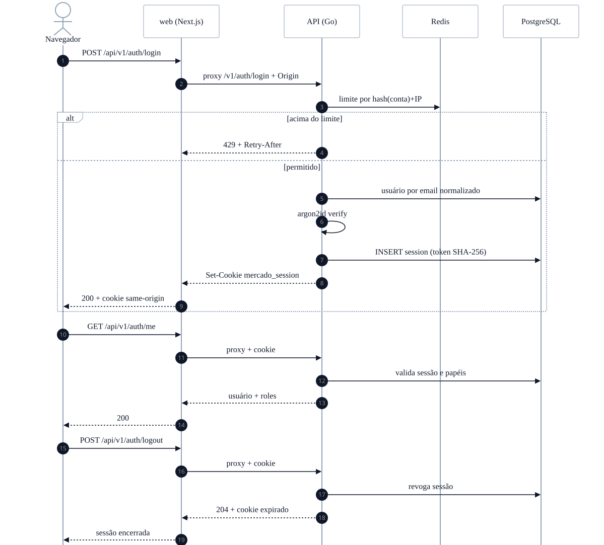

Fonte: [`auth.mmd`](diagrams/auth.mmd).

O cookie é `HttpOnly`, `SameSite=Lax`, `Path=/` e `Secure` quando HTTPS (ou
`SESSION_SECURE=true`). O banco guarda apenas o SHA-256 do token. Senhas usam
Argon2id. O proxy `/api` do Next mantém o cookie na origem do web.

## 9. Upload e leitura de imagens

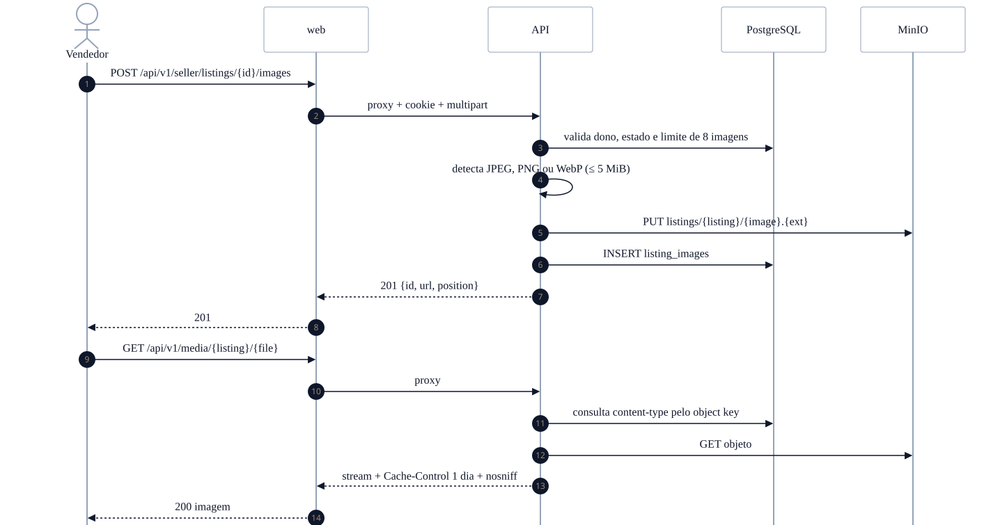

Fonte: [`imagens.mmd`](diagrams/imagens.mmd).

O upload é rejeitado em `pending_review` e `archived`. Se o registro no banco
falhar depois do `PUT`, a API remove o objeto órfão do MinIO. O limite é de 8
imagens por anúncio, 5 MiB por arquivo, apenas JPEG/PNG/WebP.

## 10. Observabilidade e deploy local


Fonte: [`observabilidade.mmd`](diagrams/observabilidade.mmd).

Bootstrap do ambiente:


Fonte: [`bootstrap-local.mmd`](diagrams/bootstrap-local.mmd).

Portas e hosts:

| URL | Serviço |
| --- | --- |
| `http://mercado.localhost:8080` | web |
| `http://api.mercado.localhost:8080` | api |
| `http://grafana.mercado.localhost:8080` | Grafana |
| `http://jaeger.mercado.localhost:8080` | Jaeger |
| `http://127.0.0.1:3001` / `:18081` | web / api via Tilt |
| `seller.` e `admin.mercado.localhost` | reservados, 404 |

Cada namespace tem `ResourceQuota` e `LimitRange`. O cluster é um único
control-plane kind; não há HA, multi-AZ nem SLA local.

## 11. CI/CD


Fonte: [`ci-cd.mmd`](diagrams/ci-cd.mmd).

A regra do projeto prevalece sobre a seção 15.1 do PRD: **PR só verifica** e
**merge na main só cria a tag**. Ver
[`docs/adr/0003-regra-de-ci-prevalece.md`](adr/0003-regra-de-ci-prevalece.md).

## 12. Estrutura do repositório

```text
mercado/
├── api/openapi.yaml              contrato REST (OpenAPI 3.1)
├── backend/
│   ├── cmd/
│   │   ├── api/                  servidor HTTP
│   │   ├── worker/               worker placeholder
│   │   ├── migrate/              goose up/down/status
│   │   ├── seed/                 dados de referência
│   │   └── seedbulk/             carga sintética
│   ├── internal/
│   │   ├── auth/                 Argon2id + token de sessão
│   │   ├── config/               variáveis e validação
│   │   ├── httpapi/              rotas, handlers, middleware
│   │   ├── platform/             postgres, redis, telemetria
│   │   ├── ratelimit/            janela fixa no Redis
│   │   ├── reference/            seeds de referência
│   │   ├── search/               normalização de busca
│   │   ├── storage/              cliente MinIO
│   │   ├── store/                acesso a dados (pgx)
│   │   └── version/
│   ├── migrations/               schema versionado (goose)
│   └── Dockerfile                imagem com api, worker e migrate
├── frontend/
│   ├── apps/web/                 Next.js 16 · App Router
│   └── packages/
│       ├── ui/                   componentes compartilhados
│       └── api-client/           cliente tipado gerado do OpenAPI
├── deploy/
│   ├── kind/cluster.yaml
│   └── k8s/
│       ├── base/                 workloads, services, ingress, jobs
│       ├── data/                 MinIO
│       ├── observability/        Prometheus, Grafana, Jaeger
│       └── overlays/local/       tag local + namespace
├── scripts/                      dev-up, seed, smoke, load, CI helpers
├── docs/                         documentação operacional e ADRs
├── openspec/                     specs e changes
├── .github/workflows/            ci.yml + release.yml
├── Makefile                      atalhos de operação
└── Tiltfile                      live update local
```

## 13. Escopo implementado x roadmap

| Capacidade | Hoje | Observação |
| --- | --- | --- |
| Identidade + sessão | Sim | Registro, login, logout, me, onboarding de vendedor. |
| Catálogo público | Sim | Busca com trigram, filtros, ordenação, paginação. |
| Gestão de anúncios | Sim | Draft, revisão, publicação, rejeição, suspensão, arquivamento. |
| Imagens | Sim | Até 8 por anúncio, 5 MiB, JPEG/PNG/WebP, MinIO. |
| Estoque | Sim | Ledger de ajustes, sem estoque negativo. |
| Administração | Parcial | API `/v1/admin/*`; sem UI de backoffice. |
| Observabilidade | Sim | Métricas, traces e dashboard local. |
| Worker assíncrono | Não | Binário sobe, conecta e fica ocioso. |
| Carrinho / checkout / pedidos | Não | Apenas no PRD. |
| Pagamentos / frete / fraude | Não | Apenas no PRD. |
| Kafka / outbox / eventos | Não | Apenas no PRD. |
| Busca dedicada (OpenSearch/Meilisearch) | Não | Busca atual é PostgreSQL + `pg_trgm`. |
| Produção cloud / GitOps / cells | Não | Ambiente local é o foco atual. |
| Push de imagem / cosign no release | Não | Por decisão da regra de CI. |

## 14. Como regenerar os diagramas

Os arquivos `.mmd` são a fonte. Exemplo para um diagrama:

```bash
PUPPETEER_EXECUTABLE_PATH=/usr/bin/google-chrome \
  npx -y @mermaid-js/mermaid-cli@11.4.2 \
  -i docs/diagrams/arquitetura-geral.mmd \
  -o docs/diagrams/arquitetura-geral.svg \
  -b white -w 2000
```

Para regenerar todos os SVGs:

```bash
for f in docs/diagrams/*.mmd; do
  PUPPETEER_EXECUTABLE_PATH=/usr/bin/google-chrome \
    npx -y @mermaid-js/mermaid-cli@11.4.2 \
    -i "$f" -o "${f%.mmd}.svg" -b white -w 1800
done
```

Para gerar também os PNGs, troque a saída para `.png` e ajuste `-w` conforme a
largura desejada. O diagrama geral usa `-w 2000`.
